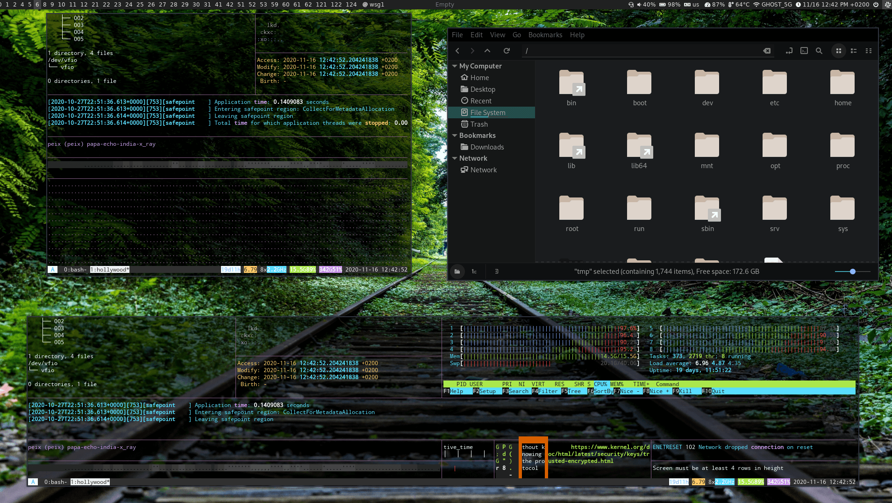

# Polybar

A fast and easy-to-use status bar

https://github.com/polybar/polybar

The shutdown menu's Sleep option schedules a user systemd timer. While it is
active, every bar shows `Sleep h:mm` (minutes rounded up), switching to seconds
below 90 seconds. Left-click the countdown to cancel it, or enter `-1` in the
Sleep prompt. Starting another timer replaces the previous one. Empty input or
`0` cancels the timer and sleeps immediately.

